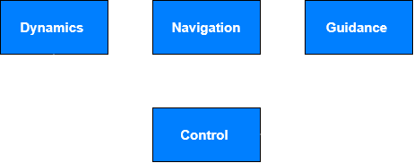

# Guidance Navigation and Control of Lockheed SR-71 'Blackbird'

## Project Introduction

This project aimed at the development of the GNC of the famous Lockheed SR-71, commonly known as 'Blackbird', as seen in the next image. 


<p align="center">
  
</p>

The GNC of the aircraft had to comply with the following requirements: 

 <ul>
  <li><strong>The GNC shall allow the aircraft to track waypoints</strong> </li>
  <li><strong>The GNC shall allow the aircraft to attain cruising speed</strong> </li>
  <li><strong>The GNC shall allow the aircraft to maintain cruising speed, once achieved</strong> </li>
</ul> 

<!--- With the architecture of the GNC being represented in the following image: 


<p align="center">
  
</p>-->

## Project Setting 


The Lockheed SR-71 is modelled as a rigid body with three degrees of freedom: its position `(x, y)` and its heading angle `θ` (following the right hand convention), moving on a 2D plane. The aircraft is treated as a point mass that can only ever move in the direction its nose is pointing, hence the heading angle controls directly the trajectory of the airplane. 


The airplane is capable of changing both its velocity and heading angle. In order to do so, it controls its motors thrust and the flight control surfaces (for generating torque), respectively. in the case of the motor thrust the controller must fight the aerodynamic drag, whereas in the case of the body-surfaces torque, it must fight rotational friction. 

Given what was said previously, the plant model (`aircraft_dynamics.c`) integrates the position and heading angle in time with a simple explicit Euler scheme (excluding linear and angular acceleration):

```
Velocity:             a = (T − c_v · v²) / m            v ← v + a · Δt
Angular Velocity:     α = (τ − c_r · ω · |ω|) / I       ω ← ω + α · Δt
Heading Angle:        θ ← θ + ω · Δt              (wrapped to the interval [−π, π])
Kinematics:           x ← x + v · cos(θ) · Δt           y ← y + v · sin(θ) · Δt
```
where `T` is thrust, `τ` is control torque, `v` is velocity, `ω` is angular velocity, and the heading angle is kept in the interval `[−π, π]` to prevent issues in the 0/2π boundary. 

The physical parameters are chosen to be representative of the real aircraft:

| Symbol | Meaning | Value |
| :--- | :--- | :--- |
| `m` | Mass | 6.9 x 10<sup>4</sup> kg |
| `I` | Moment of inertia | 6.1484175 × 10⁶ kg·m² |
| `T_max` | Maximum thrust | 302 kN |
| `τ_max` | Maximum torque | 4.918734 × 10⁶ N·m |
| `c_r` | Rotational drag coefficient | 1.23 × 10<sup>7</sup> kg·m² |
| `c_t` | Translational drag coefficient | 0.3 kg/m |
| `V_cmd` | Commanded cruise speed | 900 m/s |

The real SR-71 is powered by two Pratt & Whitney J58 (JT11D-20A) high-bypass-turbojets producing roughly 151 kN of thrust each, so the modelled maximum thrust of the aircraft is 302 kN. 

The moment of inertia was computed using the slender-rod approximation: `I` = m x L<sup>2</sup> / 12, with L being the lenght of the airplane (about 32.7 m).

Since there's no information about the maximum torque that could be generated, I assumed a maximum angular acceleration of 0.8 rad/s<sup>2</sup> and used Newton's second law for rotation: 

```
 τ_max = I · α =  6.1484175 × 10⁶ · 0.8 = 4.918734 × 10⁶ N·m
```
At maximum torque (considering only an additional movement opposing this torque), we have using Newton's second law for rotation: 
```
 τ_max - c_r · w_max · |w_max| = 0 => c_r =  τ_max/ (w_max · |w_max|) = 1.23 × 10⁷  kg·m²
 ```

For the determination of the translational drag coefficition, I used the following approximation: 
```
 c_t = 0.5·p·C_D·A = 0.5 · 0.04 · 0.09 · 167 = 0.3 kg/m
 ```

It is possible to determine the maximum speed the SR-71 can reach in these conditions, following Newton's second law:
```
 F_t = T_max - c_t · v² => c_t · v² = T_max => v = sqrt(T_max/c_t) = 1000 m/s
 ```
 As such the commanded cruise speed is of 900 m/s, which is well bellow the maximum speed the SR-71 can reach. 


Finally the aircraft must fly, in order, through the following five waypoints:

| Waypoint | x (m) | y (m) |
| :---: | ---: | ---: |
| 0 | 0 | 0 |
| 1 | 2 000 | 4 000 |
| 2 | 10 000 | 6 000 |
| 3 | 17 000 | 2 000 |
| 4 | 26 000 | 10 000 | 

## Breakdown of the different GNC subsystems  
This project was centered more on the development of the Guidance and Control modules, with a small emphasis on the Navigation module. 

### Navigation
The navigation module corrupts the spacecraft state (including position, heading and velocity) with measurement noise, and passes on only the degraded estimate. This way the controller and guidance modules do not see the perfect true state produce by the dynamics module, which mimicks the real world scenario for the Lockheed SR-71.

The noise is drawn uniformly in the range `[−1, 1]` and scaled per channel (based on the aircraft's real sensors):

| Channel | Noise amplitude |
| :--- | :--- |
| Position `x`, `y` | ± 90 m |
| Heading `θ` | ± 0.01 rad (≈ 0.57°) |
| Speed `v` | ± 2 m/s |


### Control

The control module converts the tracking and velocity errors into commands for the two actuators: the flight control surfaces (torque) and the engine (thrust), respectively. The control loops that leads to each command are independent of each other. 

### Torque Control - PD 

First the controller computes the heading error of the aircraft (the desired heading minus the current heading) and wraps this angle into into `(−π, π]`. 
Then the torque to be applied is given by the following rule: 

```
τ = Kp · e_θ − Kd · ω          (Kp = 5 × 10⁴,  Kd = 1 × 10⁵)
```

The proportional term turns the aircraft toward the desired heading. The second term is the derivative action of the PD controller, but implemented on the *measured* yaw rate `ω` rather than by differentiating the error signal — this provides damping to suppress overshoot and oscillation while avoiding the noise amplification and "derivative kick" of differentiating a noisy error. 


The torque is saturated to `± τ_max` to mimic the real flight control surfaces. 

How were the gains determined ? 
### Thrust Control - PI 


### Guidance


## Tech Stack 


