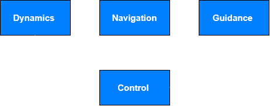
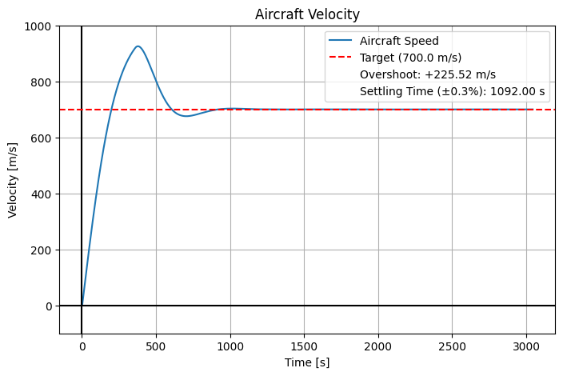
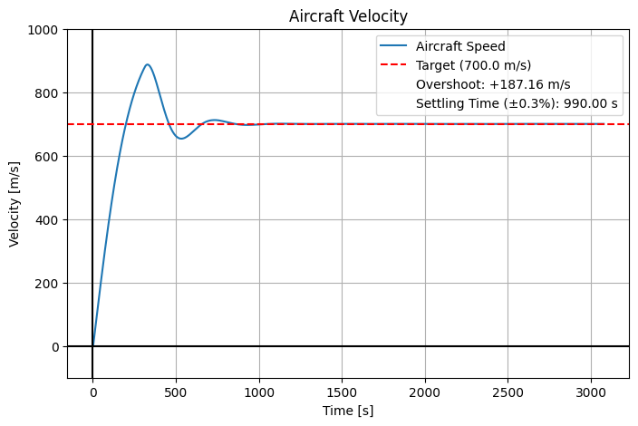
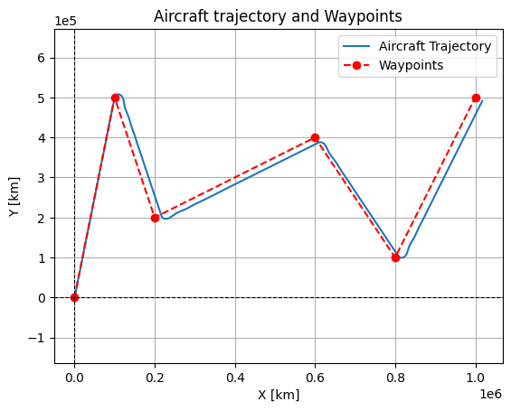

# Guidance Navigation and Control of Lockheed SR-71 'Blackbird'

## Project Introduction

This project aimed at the development of the GNC of the famous Lockheed SR-71, commonly known as 'Blackbird', as seen in the next image. 


<p align="center">
  
  <br>
  <sub><b>Figure 1: Lockheed SR-71.</sub>
</p>

The GNC of the aircraft had to comply with the following requirements: 

 <ul>
  <li><strong>The GNC shall allow the aircraft to track waypoints</strong> </li>
  <li><strong>The GNC shall allow the aircraft to attain cruising speed</strong> </li>
  <li><strong>The GNC shall allow the aircraft to maintain cruising speed, once achieved</strong> </li>
</ul> 

<!--- With the architecture of the GNC being represented in the following image: 


<p align="center">
  
</p>-->

## Project Setting 


The Lockheed SR-71 is modelled as a rigid body with three degrees of freedom: its position `(x, y)` and its heading angle `θ` (following the right hand convention), moving on a 2D plane. The aircraft is treated as a point mass that can only ever move in the direction its nose is pointing, hence the heading angle controls directly the trajectory of the airplane. 


The airplane is capable of changing both its velocity and heading angle. In order to do so, it controls its motors thrust and the flight control surfaces (for generating torque), respectively. In the case of the motor thrust the controller must fight the aerodynamic drag, whereas in the case of the body-surfaces torque, it must fight rotational friction. 

Given what was said previously, the plant model (`aircraft_dynamics.c`) integrates the position and heading angle in time with a simple explicit Euler scheme (excluding linear and angular acceleration):

```
Velocity:             a = (T − c_v · v²) / m            v ← v + a · Δt
Angular Velocity:     α = (τ − c_r · ω · |ω|) / I       ω ← ω + α · Δt
Heading Angle:        θ ← θ + ω · Δt              (wrapped to the interval [−π, π])
Kinematics:           x ← x + v · cos(θ) · Δt           y ← y + v · sin(θ) · Δt
```
where `T` is thrust, `τ` is control torque, `v` is velocity, `ω` is angular velocity, and the heading angle is kept in the interval `[−π, π]` to prevent issues in the 0/2π boundary. 

The physical parameters are chosen to be representative of the real aircraft:

| Symbol | Meaning | Value |
| :--- | :--- | :--- |
| `m` | Mass | 6.9 x 10<sup>4</sup> kg |
| `I` | Moment of inertia | 6.1484175 × 10⁶ kg·m² |
| `T_max` | Maximum thrust | 302 kN |
| `τ_max` | Maximum torque | 4.918734 × 10⁶ N·m |
| `c_r` | Rotational drag coefficient | 1.23 × 10<sup>7</sup> kg·m² |
| `c_t` | Translational drag coefficient | 0.3 kg/m |
| `V_cmd` | Commanded cruise speed | 700 m/s |

The real SR-71 is powered by two Pratt & Whitney J58 (JT11D-20A) high-bypass-turbojets producing roughly 151 kN of thrust each, so the modelled maximum thrust of the aircraft is 302 kN. 

The moment of inertia was computed using the slender-rod approximation: `I` = m x L<sup>2</sup> / 12, with L being the lenght of the airplane (about 32.7 m).

Since there's no information about the maximum torque that could be generated, I assumed a maximum angular acceleration of 0.8 rad/s<sup>2</sup> and used Newton's second law for rotation: 

```
 τ_max = I · α =  6.1484175 × 10⁶ · 0.8 = 4.918734 × 10⁶ N·m
```
At maximum torque (considering only an additional movement opposing this torque), we have using Newton's second law for rotation: 
```
 τ_max - c_r · w_max · |w_max| = 0 => c_r =  τ_max/ (w_max · |w_max|) = 1.23 × 10⁷  kg·m²
 ```

For the determination of the translational drag coefficition, I used the following approximation: 
```
 c_t = 0.5·p·C_D·A = 0.5 · 0.04 · 0.09 · 167 = 0.3 kg/m
 ```

It is possible to determine the maximum speed the SR-71 can reach in these conditions, following Newton's second law:
```
 F_t = T_max - c_t · v² => c_t · v² = T_max => v = sqrt(T_max/c_t) = 1000 m/s
 ```
 As such the commanded cruise speed is of 700 m/s, which is well bellow the maximum speed the SR-71 can reach. 


Finally the aircraft must fly, in order, through the following five waypoints:

| Waypoint | x (m) | y (m) |
| :---: | ---: | ---: |
| 0 | 0 | 0 |
| 1 | 2 000 | 4 000 |
| 2 | 10 000 | 6 000 |
| 3 | 17 000 | 2 000 |
| 4 | 26 000 | 10 000 | 

## Breakdown of the different GNC subsystems  
This project was centered more on the development of the Guidance and Control modules, with a small emphasis on the Navigation module. 

### Navigation
The navigation module corrupts the spacecraft state (including position, heading and velocity) with measurement noise, and passes on only the degraded estimate. This way the controller and guidance modules do not see the perfect true state produce by the dynamics module, which mimicks the real world scenario for the Lockheed SR-71.

The noise is drawn uniformly in the range `[−1, 1]` and scaled per channel (based on the aircraft's real sensors):

| Channel | Noise amplitude |
| :--- | :--- |
| Position `x`, `y` | ± 90 m |
| Heading `θ` | ± 0.01 rad (≈ 0.57°) |
| Speed `v` | ± 2 m/s |


### Control

The control module converts the heading and velocity errors into commands for the two actuators: the flight control surfaces (torque) and the engine (thrust), respectively. The control loops that lead to each command are independent of each other.

Together these two loops satisfy the three project requirements: the torque control loop steers the aircraft through the waypoints and the thrust control loop allows the aircraft to reach the cruising speed and maintain it (once achievied). 

#### Torque Control - PD 

Firstly the controller computes the heading error `e_θ` of the aircraft (being equal to the desired heading minus the current heading) and wraps this angle into the interval `(−π, π]`. 
Then the torque to be applied is given by the following control law: 

```
τ = Kp · e_θ − Kd · ω          (Kp = 5 × 10⁴,  Kd = 1 × 10⁵)
```

The proportional term (first term) turns the aircraft toward the desired heading. The derivative term (second term) takes into consideration the derivative of the heading error, which I approximated to be equal to the negative angular velocity of the aircraft. This approximation allows to incorporate damping to surpress overshoot and oscillation of the plane's heading angle, while avoiding the noise amplification of differentiating the desired heading (which can vary depending on the aircraft position). The gains used in this control law where choosen based on visual inspection of the aircraft's behavior while tracking the target waypoints. 
 

In the end, the torque outputted by this control law is saturated to `± τ_max` to mimic the real flight control surfaces of the Lockheed SR-71. 

#### Thrust Control - PI 

Like in the previous control loop, this one begins with the computation of the velocity error `e_v` (being equal to the desired cruising velocity minus the current aircraft velocity).
The thrust command is given by the following control law: 

```
T = Kp · e_v + Ki · ∫ e_v dt   (Kp = 500,  Ki = 10)
```

The proportional term (first term) makes the aircraft reach the desired cruising velocity. In contrast the integral term (second term), is what lets the aircraft hold cruise speed exactly: it builds up to supply the steady thrust needed to balance aerodynamic drag at the target speed, eliminating the steady-state error that a proportional-only controller would leave. As before, the gains were chosen based on a visual inspection of the controller's behavior in achieving the desired cruising velocity. Compared to the torque control law, these gains are several orders of magnitude smaller. This difference stems from the lower magnitudes of the mass and translational drag coefficients relative to the moment of inertia and rotational drag coefficients (meaning a much larger torque is required to alter the heading angle than the thrust needed to change the aircraft's velocity).

In the end of this control law, the thrust is clipped to the interval `[0, T_max]`, since the engines can neither produce negative thrust nor exceed its maximum, mimicking the SR-71's real engines. 

The problem when you use an integral term is the windup. If the actuator saturates (i.e. it has reached maximum thrust) and the error is still growing, then the integral term accumulates a lot of error that the system will struggle to clear. To prevent this, I implemented an integral anti-windup, where each time the thrust command is equal to maximum possible, the integral term does not grow. Consequently, this approach allows the aircraft to reach the desired cruising speed with a shorter settling time and reduced overshoot, as can be seen in the next image: 


<table>
  <tr>
    <td align="center">
      <br>
      <sub><b>Figure 2:</b> Aircraft velocity <b>without</b> integral anti-windup.</sub>
    </td>
    <td align="center">
      <br>
      <sub><b>Figure 3:</b> Aircraft velocity <b>with</b> integral anti-windup.</sub>
    </td>
  </tr>
</table>

As it can also be seen, there is a bit more oscillation in the aircraft velocity when using the integral anti-windup. This can be partly explained by the fact that without anti-windup, the slow unloading of the integral term hid the loop’s natural oscillations (which arise because the control loop appears to be slightly underdamped).


### Guidance


The guidance module enables waypoint tracking by providing, at every instant, a target position for the aircraft's control module to track (based on **carrot-chasing guidance**). Additionally, the switching between the specified waypoints is done externally. 

#### Waypoint Tracking
Let's begin by considering two points A and B, with point B being the destination waypoint. Then the position of tracking point T, can be defined using the following equations:

```
T_x = B_x + L · u_x
T_y=  B_y + L · u_y
```
Where L is a length constant, that captures how far beyond the aircraft looks through point B, and u is a unit-norm vector defined by:
```
u = (B-A)/||(B-A)||
```
The length L is used in order to avoid singularities in the control module when the aircraft approaches the waypoint. Moreover, it was choosen to be L = 50000 (being 1/8 of the average distance between the considered waypoints).

#### Waypoint Switching 

To know when it is time to move on to the next waypoint, the vector connecting point A to the aircraft's position is projected onto the segment AB. If this projection has a length equal to or bigger than the length of the segment AB then the aircraft can begin tracking the next waypoint. Because this test is based on progress along the segment AB rather than on proximity to the point B, the aircraft does not have to pass exactly over the waypoint to trigger a switch (preventing it from circulating around a waypoint, as it would happen with acceptance radius). However, this can lead the aircraft to have some cross-track error when tracking target waypoints, as will be seen in the **Results**. 

The switching logic begins with the definition of the vector k, which is defined as:

```
k = P-A
```
Where P is the aircraft's position.
After this, the length of the projection of this vector onto vector u is obtained using the dot product: 
```
s = k · u
```
If this length is equal to or bigger than `||A-B||`, then the aircraft beggins tracking the next waypoint. 

#### Results 

Finally, Figure 4 shows the aircraft tracking the waypoints while controlling both its velocity and heading angle. The aircraft correctly tracks each waypoint, however with some cross-track error after the second waypoint, as expected. 

<p align="center">
  
  <br>
  <sub><b>Figure 4:</b> Aircraft waypoint tracking.</sub>
</p>

      

## Tech Stack 
The simulation is written entirely in **C** and depends only on the libraries: `stdio.h` and `math.h`. In contrast the plots were done using python. 

Finally, the use of AI in this project was minimal, either for ideas, helping writing this readme or for generating the plot.ipynb file. 


